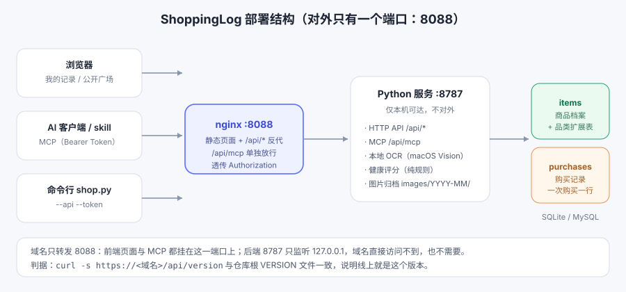
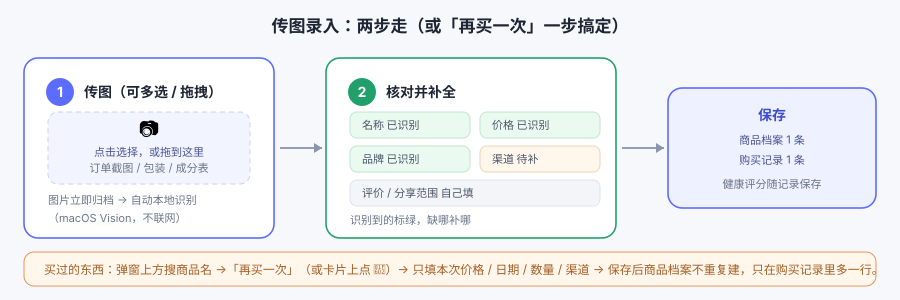

# ShoppingLog

**当前版本：v0.6.10**

多用户购物记录服务：记下每一次买的东西、花多少钱、值不值得回购。网页 / 命令行 / AI 客户端三种入口，
SQLite / MySQL 双后端，识别与评分全部在本地完成，不上任何模型 API。

English: [README.en.md](README.en.md)



## 功能

**记录**
- 网页新增 / 编辑 / 删除，卡片 + 表格两种视图，搜索、筛选、分类与月度图表
- **传图录入**：多选或拖拽订单截图、包装、营养成分表 → 本地 OCR 自动填充 → 核对补漏 → 保存
- **食品健康评分**：纯规则算法（糖 / 钠 / 脂肪 / 膳食纤维 / 添加剂等）给出 0-100 分与理由
- 图片随选随存、可单张删除；编辑时也能追加

**商品与购买记录**
- 商品档案与购买记录分开存：同一件商品买 N 次只有一份商品信息 + N 条购买记录
- 自动算复购次数、累计花费、均价、最低 / 最高价、首次与最近购买日期
- **再买一次**：弹窗里搜已有商品，或卡片上点 🛒，只补本次价格 / 日期 / 数量 / 渠道

**分享**
- 每条记录可选公开 / 私有；公开广场 `/public.html` 免登录可看，按商品聚合多人的评价
- 只公开商品图文、成分与评价，**价格、购买日期、渠道等购买记录一律不出去**

**账号与接入**
- 多用户数据隔离；密码强度校验、改密、Token 自助重置；管理员后台 + 用户回收站
- MCP 服务内置在服务端（`POST /api/mcp`，9 个工具），AI 客户端用 API Token 访问，不碰数据库
- CLI `scripts/shop.py` 同样走 Token

## 安装

```bash
# 1. 克隆
git clone <repo-url> ShoppingLog && cd ShoppingLog

# 2. 建库（默认 SQLite；users/settings/items/purchases/品类扩展表 + 默认管理员）
python3 -m venv .venv && source .venv/bin/activate
python3 scripts/migrate.py

# 3. 启动 API 服务（只监听 127.0.0.1:8787）
mkdir -p logs
nohup python3 scripts/server.py --port 8787 >> logs/server.log 2>&1 &

# 4. nginx 对外（参考 docs/nginx.shopping.conf.example）
#    监听 8088：静态页面 + /api/* 反代；/api/mcp 单独放行并透传 Authorization

# 5. 常驻托管（推荐 supervisord 统一托管，开机自启 + 崩溃自动拉起）
cp docs/supervisor.shoppinglog.ini.example ~/myapp/supervisor/conf.d/shoppinglog.ini   # 按需改路径
supervisorctl -c ~/myapp/supervisor/supervisord.conf reread && update
supervisorctl -c ~/myapp/supervisor/supervisord.conf status shoppinglog   # 应为 RUNNING

# 5b. 没有 supervisord 的机器可退化为 macOS ~/Library/LaunchAgents
bash scripts/install-service.sh            # 写 plist + 注册。注意：要在普通终端里跑，
                                            # 受限终端/沙箱里 launchctl 会报 Input/output error
bash scripts/install-service.sh --status    # 看状态：state = running 表示已托管
bash scripts/install-service.sh --uninstall # 不再自启

托管后：登录后自动拉起、崩溃自动重启（MySQL 还没就绪时会重试直到连上）。
日常升级直接 `bash scripts/deploy.sh`：script会自动识别托管方式（supervisord → LaunchAgent → 双 fork），
按对应方式重启服务并校验版本，不会把服务降级成脱离托管的裸进程。
```

打开 `http://localhost:8088`。首次部署会自动创建管理员，账号密码写在 `data/INITIAL_ADMIN.txt`，
登录后请立即改密码并删除该文件。公开广场免登录：`http://localhost:8088/public.html`。

切 MySQL：`config.local.json` 里设 `db.engine = "mysql"`，详见 [docs/MYSQL.md](docs/MYSQL.md)。

## 传图录入怎么用



1. 点「＋ 新增记录」→ 选择或拖入图片（可多选），图片立即归档并自动本地识别
2. 识别完自动展开表单，识别到的字段标绿，缺的手动补（名称和价格必填）
3. 保存。若这是买过的东西，改在第二步上方搜已有商品「再买一次」，只填本次购买信息

## 文档

| 文档 | 内容 |
|---|---|
| [docs/CHANGELOG.md](docs/CHANGELOG.md) | 版本更新记录 |
| [docs/api.md](docs/api.md) | HTTP API 与 MCP 接口说明 |
| [docs/TESTING.md](docs/TESTING.md) | 测试与部署验收（commit 前必须全绿） |
| [docs/DESIGN.md](docs/DESIGN.md) | 架构与程序设计 |
| [docs/schema.md](docs/schema.md) · [docs/schema.sql](docs/schema.sql) | 表结构设计与建表语句 |
| [docs/MYSQL.md](docs/MYSQL.md) | MySQL 部署与迁移 |
| [docs/ROADMAP.md](docs/ROADMAP.md) | 后续计划 |
| [docs/nginx.shopping.conf.example](docs/nginx.shopping.conf.example) | nginx 配置示例 |
|[docs/supervisor.shoppinglog.ini.example](docs/supervisor.shoppinglog.ini.example) | supervisord 服务配置模板 |
